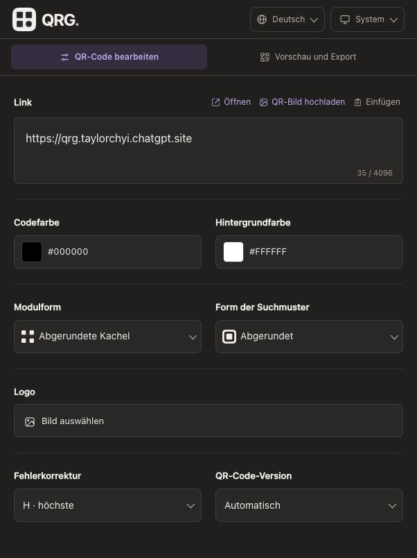
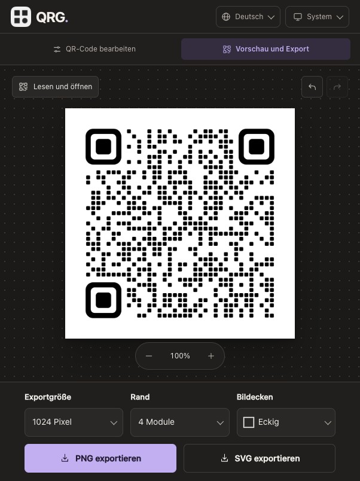

<h1 align="center">QRG</h1>

  
  
  

<a href="README.md">简体中文</a> · <a href="README.zh-TW.md">繁體中文</a> · <a href="README.en.md">English</a> · <a href="README.ja.md">日本語</a> · <a href="README.ko.md">한국어</a> · <a href="README.es.md">Español</a> · <a href="README.fr.md">Français</a> · <strong>Deutsch</strong>

<strong>Erstellen Sie online einen QR-Code, der zu Ihrem Link passt.</strong>

Live-Vorschau · Eigene Farben und Logos · PNG- und SVG-Export · Verarbeitung im Browser

<a href="https://qrg.taylorchyi.chatgpt.site/?lang=de"><strong>QRG jetzt nutzen →</strong></a>

Mit QRG gestalten Sie QR-Codes für Websites, Plakate, Visitenkarten und Präsentationen. Fügen Sie einen Link oder Text ein, passen Sie das Design an und laden Sie das Ergebnis herunter. Eine Installation ist nicht nötig.

  
  

## In drei Schritten zum QR-Code

1. Öffnen Sie [QRG online](https://qrg.taylorchyi.chatgpt.site/?lang=de) und fügen Sie einen Link oder Text ein.
2. Wählen Sie Farben, Formen und Hintergrund. Ergänzen Sie bei Bedarf ein Logo und verfolgen Sie die Änderungen in der Vorschau.
3. Laden Sie eine PNG-Datei herunter oder wählen Sie SVG für weitere Gestaltung und Druckvorbereitung.

Sie haben bereits ein QR-Code-Bild? Laden Sie eine PNG-, JPEG- oder WebP-Datei hoch, ziehen Sie sie in die Seite oder fügen Sie sie ein. QRG liest den Inhalt aus; das neue Design bestimmen Sie selbst.

## Gestalten Sie Ihren QR-Code

| Funktion | Das ist möglich |
| --- | --- |
| Farben und Hintergrund | Legen Sie die Farben des Codes und des Hintergrunds fest – auch ein transparenter Hintergrund ist möglich. |
| Formen und Ecken | Wählen Sie quadratische Module, abgerundete Kacheln oder runde Punkte. Passen Sie Positionsmarken und äußere Bildecken getrennt an. |
| Eigenes Logo | Laden Sie ein Bild hoch, schneiden Sie es zu und ändern Sie Größe sowie Freiraum. Die verfügbaren Einstellungen passen sich dem QR-Code an. |
| Live-Bearbeitung | Die Vorschau aktualisiert sich automatisch. Machen Sie Änderungen rückgängig, stellen Sie sie wieder her und zoomen Sie in das Ergebnis. |
| PNG und SVG | Exportieren Sie PNGs mit 256, 512, 1024, 2048 oder 4096 Pixeln. SVG eignet sich für weitere Gestaltung und Vergrößerung. |
| Bilderkennung | Lesen Sie den Inhalt eines vorhandenen QR-Codes aus. Sie können auch die aktuelle Vorschau scannen und den enthaltenen Weblink öffnen. |

Auf dem Computer stehen Editor und Vorschau nebeneinander. Auf dem Smartphone wechseln Sie zwischen Bearbeitung und Export. QRG unterstützt helles, dunkles und systemabhängiges Erscheinungsbild sowie Oberflächen auf vereinfachtem Chinesisch, traditionellem Chinesisch, Englisch, Japanisch, Koreanisch, Spanisch, Französisch und Deutsch.

## Verarbeitung im Browser

Die öffentliche Online-Version erstellt und liest QR-Codes direkt in Ihrem Browser. Text, Logo und importierte Bilder werden nicht an einen QR-Verarbeitungsdienst hochgeladen; QRG nutzt auch keine fremde API zur QR-Code-Erstellung.

Für den Druck oder bei Verwendung eines Logos sollten Sie auf hohen Kontrast und einen ausreichenden Rand achten. Prüfen Sie den fertigen Code durch Scannen unter den späteren Einsatzbedingungen.

## Selbst hosten und Kommandozeile

Sie können den QRG-Webdienst auch auf Ihrem eigenen Server betreiben oder PNG- und SVG-Dateien über die Kommandozeile erzeugen. In der selbst gehosteten Webversion verarbeitet Ihr eigener QRG-Server Inhalte und Bilder.

Hinweise zu Einrichtung, API und Wartung finden Sie in [AGENTS.md](AGENTS.md).
