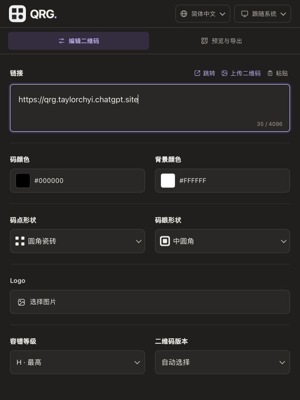
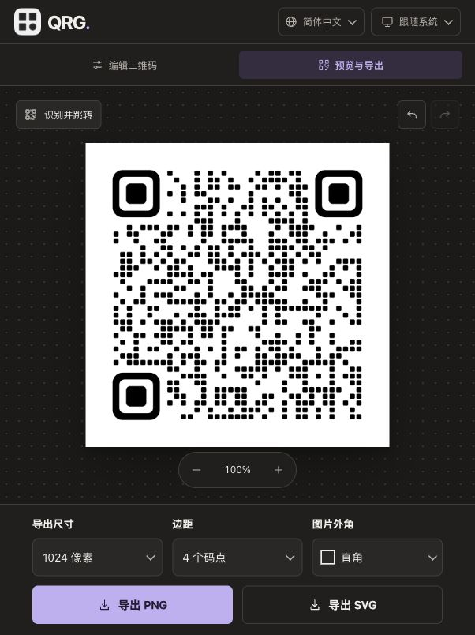

<h1 align="center">QRG</h1>

  
  
  

<a href="README.md">简体中文</a> · <strong>English</strong>

<strong>Make a QR code that suits your link.</strong>

Live preview · Custom colours and logos · PNG and SVG export · Processing in your browser

<a href="https://qrg.taylorchyi.chatgpt.site/?lang=en"><strong>Try QRG online →</strong></a>

QRG is an online QR code generator for websites, posters, business cards and presentations. Paste a link or enter text, adjust the design and download the result. There is nothing to install.

  
  

## From link to QR code in three steps

1. Open [QRG online](https://qrg.taylorchyi.chatgpt.site/?lang=en) and paste a link or enter text.
2. Choose colours, shapes and a background. Add a logo if you like, and see the preview update as you edit.
3. Download a PNG, or choose SVG for further layout and print work.

Already have a QR code image? Upload, drag in or paste a PNG, JPEG or WebP image to read its content and create a new design. QRG reads the content; you choose the new style.

## Make it your own

| Feature | What you can do |
| --- | --- |
| Colours and background | Choose code and background colours, including a transparent background. |
| Shapes and corners | Use square, rounded tile or circular modules. Adjust the corner markers and the outer image corners separately. |
| Your logo | Upload and crop an image, then adjust its size and surrounding clear space. Available choices adapt to the QR code. |
| Live editing | Preview changes automatically, undo and redo edits, and zoom into the result. |
| PNG and SVG | Export PNGs at 256, 512, 1024, 2048 or 4096 pixels, or use SVG for further layout and enlargement. |
| Image recognition | Read content from an existing QR code, or scan the current preview and open its web link. |

On a computer, editing and preview sit side by side. On a phone, you can switch between editing and export. QRG supports light, dark and system appearance, with interfaces in Simplified Chinese, Traditional Chinese, English, Japanese, Korean, Spanish, French and German.

## Made in your browser

The public online version generates and reads QR codes in your browser. Your text, logo and imported images are not uploaded to a QR processing service, and QRG does not use a third-party QR generation API.

For printed materials or designs with a logo, keep good colour contrast and clear margins, then scan the finished code in its intended setting.

## Self-hosting and command line

You can also run QRG's Web service on your own server or generate PNG and SVG files from the command line. In the self-hosted Web version, your QRG server processes the content and images.

Setup, API and maintenance details are in [AGENTS.md](AGENTS.md).
