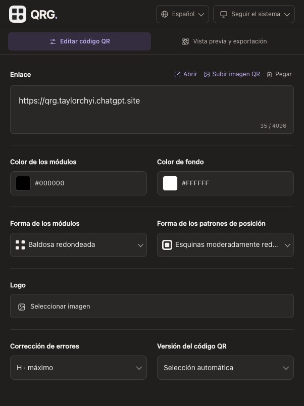
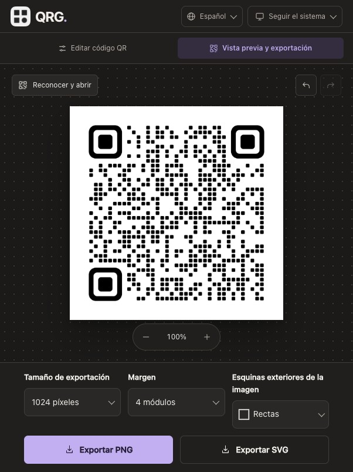

<h1 align="center">QRG</h1>

  
  
  

<a href="README.md">简体中文</a> · <a href="README.zh-TW.md">繁體中文</a> · <a href="README.en.md">English</a> · <a href="README.ja.md">日本語</a> · <a href="README.ko.md">한국어</a> · <strong>Español</strong> · <a href="README.fr.md">Français</a> · <a href="README.de.md">Deutsch</a>

<strong>Crea en línea un código QR que encaje con tu enlace.</strong>

Vista previa al instante · Colores y logotipo a tu gusto · Exportación PNG / SVG · Procesamiento en tu navegador

<a href="https://qrg.taylorchyi.chatgpt.site/?lang=es"><strong>Probar QRG →</strong></a>

QRG es una herramienta en línea para crear códigos QR para sitios web, carteles, tarjetas de visita y presentaciones. Pega un enlace o escribe un texto, ajusta el diseño y descarga el resultado. No hace falta instalar nada.

  
  

## De un enlace a un código QR en tres pasos

1. Abre [QRG en línea](https://qrg.taylorchyi.chatgpt.site/?lang=es) y pega un enlace o escribe un texto.
2. Elige colores, formas y fondo. Si quieres, añade un logotipo y comprueba los cambios en la vista previa.
3. Descarga un PNG o elige SVG para seguir maquetando o preparar la impresión.

¿Ya tienes una imagen con un código QR? Sube, arrastra o pega un archivo PNG, JPEG o WebP para leer su contenido y crear un diseño nuevo. QRG recupera el contenido; tú decides el estilo.

## Dale tu propio estilo

| Función | Qué puedes hacer |
| --- | --- |
| Colores y fondo | Elige los colores del código y del fondo, incluido un fondo transparente. |
| Formas y esquinas | Usa módulos cuadrados, con esquinas redondeadas o circulares. Ajusta por separado los marcadores de posición y las esquinas exteriores de la imagen. |
| Tu logotipo | Sube y recorta una imagen; ajusta su tamaño y el espacio libre alrededor. Las opciones disponibles se adaptan al código QR. |
| Edición en tiempo real | La vista previa se actualiza automáticamente. Puedes deshacer, rehacer y ampliar el resultado. |
| PNG y SVG | Exporta PNG de 256, 512, 1024, 2048 o 4096 píxeles, o usa SVG para seguir maquetando y ampliar. |
| Lectura de imágenes | Lee el contenido de un código QR existente o analiza la vista previa actual y abre su enlace web. |

En el ordenador, el editor y la vista previa aparecen uno junto al otro. En el móvil, puedes alternar entre edición y exportación. QRG ofrece apariencia clara, oscura o según el sistema, e interfaz en chino simplificado, chino tradicional, inglés, japonés, coreano, español, francés y alemán.

## Se procesa en tu navegador

La versión pública en línea genera y lee códigos QR en tu navegador. El texto, el logotipo y las imágenes importadas no se suben a un servicio de procesamiento de códigos QR; tampoco se usa una API de generación de terceros.

Si vas a imprimir el código o añadir un logotipo, conserva un buen contraste y márgenes suficientes. Comprueba que se pueda escanear en las condiciones en las que se utilizará.

## Alojamiento propio y línea de comandos

También puedes ejecutar el servicio web de QRG en tu servidor o crear archivos PNG y SVG desde la línea de comandos. En la versión web alojada por ti, tu servidor QRG procesa el contenido y las imágenes.

Los detalles de instalación, API y mantenimiento están en [AGENTS.md](AGENTS.md).
