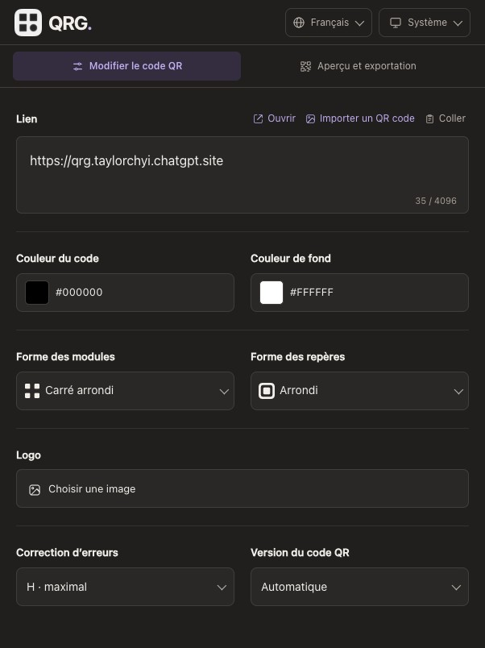
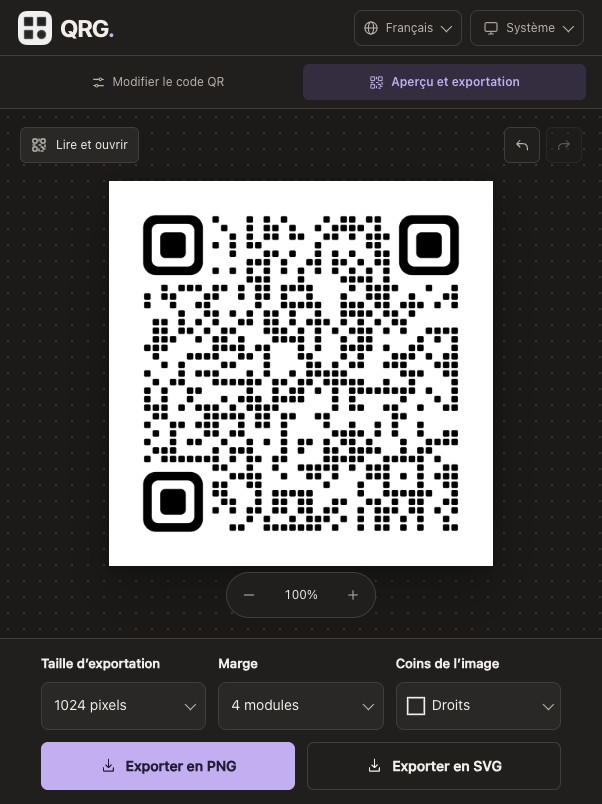

<h1 align="center">QRG</h1>

  
  
  

<a href="README.md">简体中文</a> · <a href="README.zh-TW.md">繁體中文</a> · <a href="README.en.md">English</a> · <a href="README.ja.md">日本語</a> · <a href="README.ko.md">한국어</a> · <a href="README.es.md">Español</a> · <strong>Français</strong> · <a href="README.de.md">Deutsch</a>

<strong>Créez en ligne un code QR à l’image de votre lien.</strong>

Aperçu instantané · Couleurs et logo personnalisés · Export PNG / SVG · Traitement dans votre navigateur

<a href="https://qrg.taylorchyi.chatgpt.site/?lang=fr"><strong>Essayer QRG →</strong></a>

QRG est un outil en ligne pour créer des codes QR destinés aux sites web, affiches, cartes de visite et présentations. Collez un lien ou saisissez du texte, personnalisez le résultat et téléchargez-le. Aucune installation n’est nécessaire.

  
  

## Du lien au code QR en trois étapes

1. Ouvrez [QRG en ligne](https://qrg.taylorchyi.chatgpt.site/?lang=fr) et collez un lien ou saisissez du texte.
2. Choisissez les couleurs, la forme et le fond. Ajoutez un logo si vous le souhaitez et voyez les changements immédiatement.
3. Téléchargez un PNG ou choisissez un SVG pour poursuivre la mise en page ou préparer l’impression.

Vous avez déjà une image de code QR ? Importez, glissez-déposez ou collez un fichier PNG, JPEG ou WebP pour en lire le contenu et créer un nouveau visuel. QRG récupère le contenu ; vous définissez le nouveau style.

## Un code QR à votre image

| Fonction | Ce que vous pouvez faire |
| --- | --- |
| Couleurs et fond | Choisissez la couleur du code et celle du fond, ou optez pour un fond transparent. |
| Formes et angles | Utilisez des modules carrés, aux coins arrondis ou ronds. Réglez séparément les repères de positionnement et les angles extérieurs de l’image. |
| Votre logo | Importez et recadrez une image, puis ajustez sa taille et l’espace libre autour. Les choix disponibles s’adaptent au code QR. |
| Édition en temps réel | L’aperçu se met à jour automatiquement ; annulez, rétablissez et zoomez selon vos besoins. |
| PNG et SVG | Exportez un PNG en 256, 512, 1024, 2048 ou 4096 pixels, ou utilisez le SVG pour la mise en page et l’agrandissement. |
| Lecture d’image | Lisez le contenu d’un code QR existant, ou analysez l’aperçu actuel pour ouvrir son lien web. |

Sur ordinateur, l’éditeur et l’aperçu s’affichent côte à côte. Sur téléphone, passez de l’édition à l’export. QRG propose les modes clair, sombre et système, ainsi qu’une interface en chinois simplifié, chinois traditionnel, anglais, japonais, coréen, espagnol, français et allemand.

## Tout se passe dans votre navigateur

La version publique en ligne crée et lit les codes QR dans votre navigateur. Votre texte, votre logo et les images importées ne sont pas envoyés à un service de traitement de codes QR ; QRG ne fait pas non plus appel à une API tierce pour les générer.

Pour l’impression ou l’ajout d’un logo, gardez un contraste suffisant et des marges dégagées. Vérifiez le code final en le scannant dans ses conditions réelles d’utilisation.

## Auto-hébergement et ligne de commande

Vous pouvez aussi exécuter le service web QRG sur votre serveur ou générer des fichiers PNG et SVG en ligne de commande. Dans la version web auto-hébergée, le contenu et les images sont traités par votre propre serveur QRG.

Les informations sur l’installation, l’API et la maintenance figurent dans [AGENTS.md](AGENTS.md).
