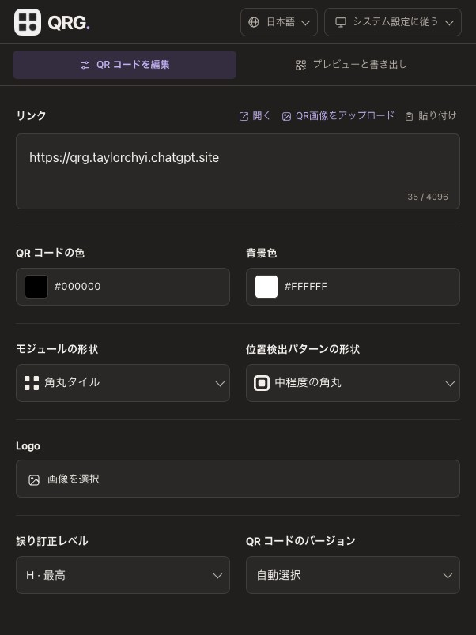
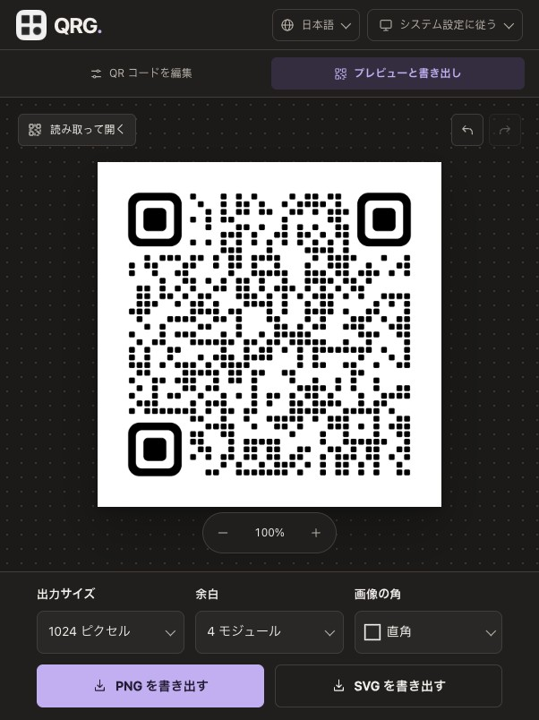

<h1 align="center">QRG</h1>

  
  
  

<a href="README.md">简体中文</a> · <a href="README.zh-TW.md">繁體中文</a> · <a href="README.en.md">English</a> · <strong>日本語</strong> · <a href="README.ko.md">한국어</a> · <a href="README.es.md">Español</a> · <a href="README.fr.md">Français</a> · <a href="README.de.md">Deutsch</a>

<strong>リンクに合ったデザインの QR コードを、オンラインで。</strong>

リアルタイムプレビュー · 色とロゴをカスタマイズ · PNG / SVG で保存 · ブラウザー内で処理

<a href="https://qrg.taylorchyi.chatgpt.site/?lang=ja"><strong>今すぐ使う →</strong></a>

QRG は、ウェブサイト、ポスター、名刺、プレゼンテーションに使う QR コードを作れるオンラインツールです。リンクを貼り付けるか文字を入力し、見た目を整えてダウンロードできます。インストールは不要です。

  
  

## 3 ステップで QR コードを作成

1. [QRG オンライン版](https://qrg.taylorchyi.chatgpt.site/?lang=ja)を開き、リンクを貼り付けるか文字を入力します。
2. 色、形、背景を選び、必要に応じてロゴを追加します。変更はその場でプレビューできます。
3. PNG をダウンロードするか、レイアウトや印刷に使いやすい SVG を選びます。

すでに QR コードの画像がある場合は、PNG、JPEG、WebP をアップロード、ドラッグ＆ドロップ、または貼り付けて内容を読み取れます。読み取った内容を使い、デザインは新しく設定できます。

## 自分らしい仕上がりに

| 機能 | できること |
| --- | --- |
| 色と背景 | コードと背景の色を選択。背景を透明にもできます。 |
| 形と角丸 | 四角、角丸タイル、丸いドットから選び、位置検出パターンと画像の外角をそれぞれ調整できます。 |
| ロゴ | 画像をアップロードして切り抜き、大きさと周囲の余白を調整。選べる範囲は QR コードに合わせて変わります。 |
| リアルタイム編集 | プレビューの自動更新、元に戻す・やり直し、拡大表示に対応します。 |
| PNG と SVG | PNG は 256、512、1024、2048、4096 ピクセルから選択。SVG はレイアウトの調整や拡大に便利です。 |
| 画像の読み取り | 既存の QR コードから内容を読み取り、現在のプレビュー内のウェブリンクを開くこともできます。 |

パソコンでは編集画面とプレビューを並べて表示し、スマートフォンでは編集と書き出しの画面を切り替えられます。ライト、ダーク、システム設定に合わせた表示に対応。画面の言語は簡体字中国語、繁体字中国語、英語、日本語、韓国語、スペイン語、フランス語、ドイツ語から選べます。

## ブラウザー内で処理

公開オンライン版では、QR コードの生成と読み取りをお使いのブラウザー内で行います。入力した文字、ロゴ、取り込んだ画像を QR コード処理サービスへアップロードせず、外部の QR コード生成 API も使いません。

印刷する場合やロゴを入れる場合は、色のコントラストと余白を十分に取り、実際の使用環境で完成したコードを読み取れるか確認してください。

## セルフホストとコマンドライン

QRG の Web サービスを自分のサーバーで動かしたり、コマンドラインから PNG や SVG を生成したりすることもできます。セルフホスト版の Web サービスでは、内容と画像をその QRG サーバーで処理します。

導入方法、API、保守については [AGENTS.md](AGENTS.md) をご覧ください。
