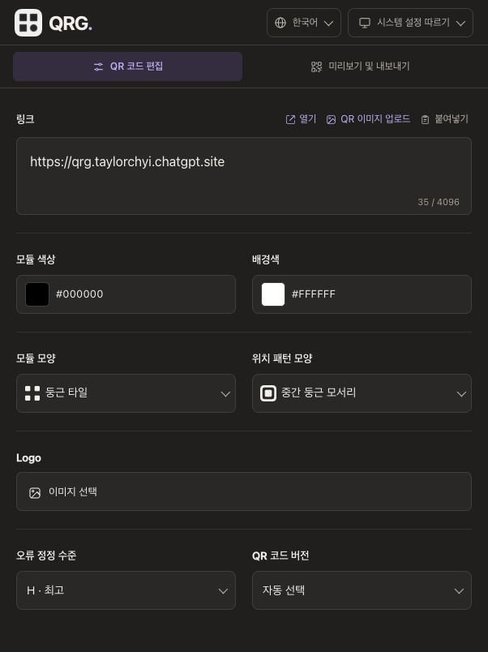
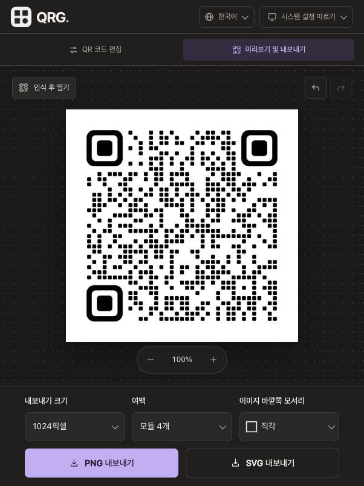

<h1 align="center">QRG</h1>

  
  
  

<a href="README.md">简体中文</a> · <a href="README.zh-TW.md">繁體中文</a> · <a href="README.en.md">English</a> · <a href="README.ja.md">日本語</a> · <strong>한국어</strong> · <a href="README.es.md">Español</a> · <a href="README.fr.md">Français</a> · <a href="README.de.md">Deutsch</a>

<strong>링크에 어울리는 QR 코드를 온라인에서 만들어 보세요.</strong>

실시간 미리보기 · 색상과 로고 맞춤 설정 · PNG / SVG 내보내기 · 브라우저에서 처리

<a href="https://qrg.taylorchyi.chatgpt.site/?lang=ko"><strong>지금 사용하기 →</strong></a>

QRG는 웹사이트, 포스터, 명함, 발표 자료에 쓸 QR 코드를 만드는 온라인 도구입니다. 링크를 붙여 넣거나 글을 입력하고 디자인을 조정한 뒤 내려받으세요. 설치할 필요가 없습니다.

  
  

## 세 단계로 QR 코드 만들기

1. [QRG 온라인 버전](https://qrg.taylorchyi.chatgpt.site/?lang=ko)을 열고 링크를 붙여 넣거나 글을 입력합니다.
2. 색상, 모양, 배경을 고르고 필요하면 로고를 추가합니다. 바꾸는 즉시 미리보기에 반영됩니다.
3. PNG를 내려받거나, 편집과 인쇄에 활용할 SVG를 선택합니다.

이미 QR 코드 이미지가 있나요? PNG, JPEG, WebP 이미지를 업로드하거나 끌어다 놓거나 붙여 넣어 내용을 읽을 수 있습니다. 읽어 온 내용으로 새 디자인을 만들어 보세요.

## 원하는 모습으로 꾸미기

| 기능 | 할 수 있는 일 |
| --- | --- |
| 색상과 배경 | QR 코드와 배경 색상을 고르고 투명 배경도 사용할 수 있습니다. |
| 모양과 둥근 모서리 | 사각형, 둥근 타일, 원형 모듈을 선택하고 위치 표시 패턴과 이미지 바깥쪽 모서리를 따로 조정합니다. |
| 로고 | 이미지를 올리고 자른 뒤 크기와 주변 여백을 조정합니다. 선택지는 QR 코드 규격에 맞춰 달라집니다. |
| 실시간 편집 | 미리보기가 자동으로 갱신되며 실행 취소, 다시 실행, 확대·축소를 지원합니다. |
| PNG와 SVG | PNG는 256, 512, 1024, 2048, 4096픽셀 중에서 내보낼 수 있습니다. SVG는 추가 편집과 확대에 편리합니다. |
| 이미지 인식 | 기존 QR 코드의 내용을 읽거나 현재 미리보기를 인식해 웹 링크를 열 수 있습니다. |

컴퓨터에서는 편집 화면과 미리보기를 나란히 볼 수 있고, 휴대전화에서는 편집과 내보내기 화면을 전환할 수 있습니다. 밝은 테마, 어두운 테마, 시스템 설정을 지원하며 인터페이스 언어는 중국어 간체, 중국어 번체, 영어, 일본어, 한국어, 스페인어, 프랑스어, 독일어 중에서 선택할 수 있습니다.

## 브라우저에서 처리

공개 온라인 버전은 방문자의 브라우저에서 QR 코드를 만들고 읽습니다. 입력한 글, 로고, 가져온 이미지를 QR 코드 처리 서비스로 업로드하지 않으며, 외부 QR 코드 생성 API도 사용하지 않습니다.

인쇄하거나 로고를 넣을 때는 색상 대비와 여백을 충분히 확보하고, 실제 사용할 환경에서 완성된 코드를 스캔해 확인하세요.

## 직접 호스팅과 명령줄

QRG 웹 서비스를 자신의 서버에서 실행하거나 명령줄에서 PNG와 SVG 파일을 만들 수도 있습니다. 직접 호스팅하는 웹 버전에서는 해당 QRG 서버가 내용과 이미지를 처리합니다.

설치, API, 유지 관리에 관한 내용은 [AGENTS.md](AGENTS.md)를 참고하세요.
