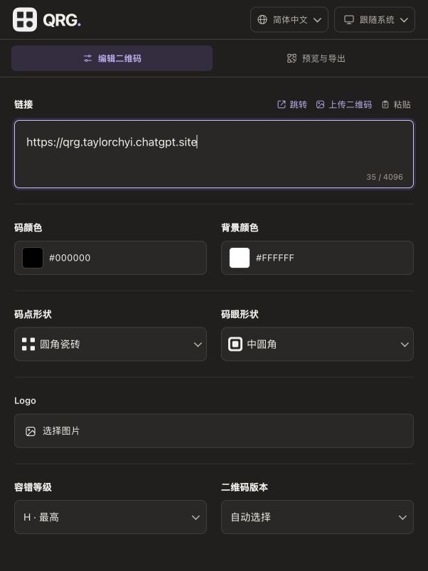
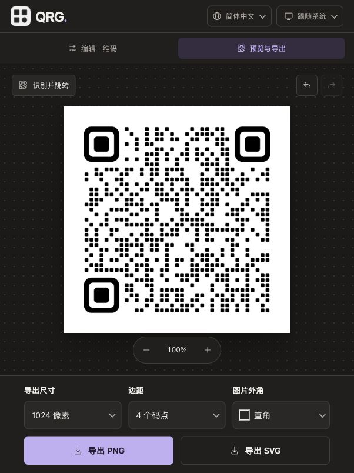

<h1 align="center">QRG</h1>

  
  
  

<strong>简体中文</strong> · <a href="README.en.md">English</a>

<strong>在线制作二维码，让每个链接都有合适的样式。</strong>

实时预览 · 自定义颜色与 Logo · PNG / SVG 导出 · 浏览器内处理

<a href="https://qrg.taylorchyi.chatgpt.site"><strong>立即使用 →</strong></a>

QRG 是一个在线二维码工具。在浏览器中粘贴链接、调整样式，就能导出适合网页、海报、名片或演示文稿的二维码，无需安装。

  
  

## 从链接到二维码，只需三步

1. 打开 [QRG 在线版](https://qrg.taylorchyi.chatgpt.site)，粘贴链接或输入文字。
2. 选择颜色、形状和背景，按需添加 Logo，实时查看效果。
3. 导出 PNG 图片，或下载 SVG，用于继续排版与印刷。

已有二维码图片？上传、拖入或粘贴 PNG、JPEG、WebP 图片，识别内容后即可重新制作。导入会读取内容，样式由你重新设置。

## 做出适合你的二维码

| 功能 | 可以做什么 |
| --- | --- |
| 颜色与背景 | 自定义码色、背景色，支持透明背景，方便融入不同设计。 |
| 形状与圆角 | 选择方形、圆角瓷砖或圆形码点，分别设置码眼和图片外角。 |
| 品牌 Logo | 上传图片、裁剪范围、调整大小与留白；可用选项随二维码规格变化。 |
| 实时编辑 | 自动更新预览，支持撤销、重做和预览缩放。 |
| PNG 与 SVG | PNG 提供 256、512、1024、2048、4096 像素尺寸；SVG 适合继续排版和放大。 |
| 图片识别 | 从已有二维码提取内容，也能识别当前预览并打开其中的网页链接。 |

电脑版并排编辑与预览，手机可切换编辑和导出视图。支持浅色、深色及跟随系统外观，并提供简体中文、繁體中文、English、日本語、한국어、Español、Français、Deutsch 八种语言。

## 在浏览器里完成

公开在线版在你的浏览器内生成和识别二维码，输入内容、Logo 和导入图片不上传到二维码处理服务，也不调用第三方二维码生成接口。

用于印刷或添加 Logo 时，建议保留清晰的颜色对比和边距，并在最终展示环境中扫码确认。

## 自部署与命令行

除了在线使用，QRG 也支持在自己的服务器运行 Web 服务，或通过命令行生成 PNG、SVG。在自部署版中，内容和图片由你自己的 QRG 服务器处理。

安装、运行、接口和维护说明见 [AGENTS.md](AGENTS.md)。
