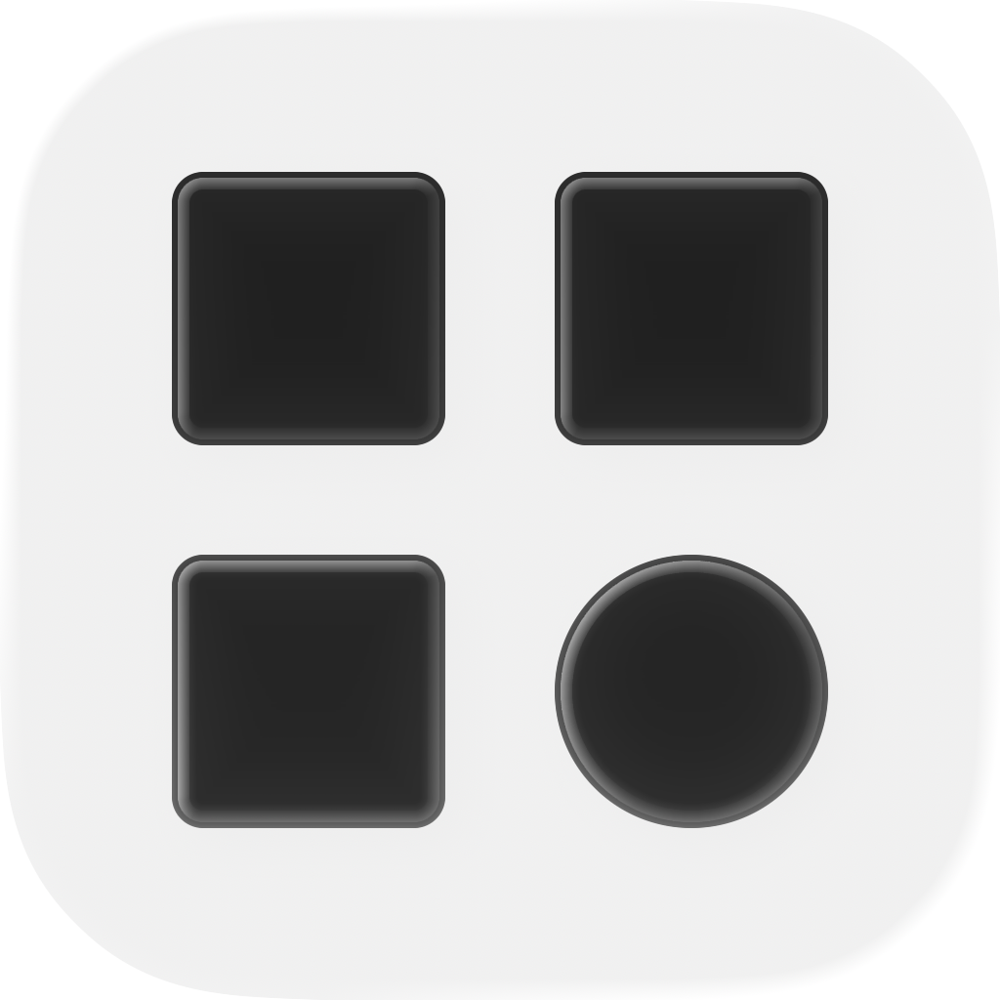

<p align="center"></p>

# QRG

二维码工具，当前开发范围为可自部署的 Web 界面及其共用的命令行生成能力。输入链接，输出 PNG 或 SVG。命令行在本机生成；Web 版在运行 QRG 的服务器生成，不调用第三方二维码服务。仓库保留既有 macOS 图形界面源码和使用说明，但不再开发或进行日常构建、测试与验收。

## Web 版与调测 Action

需要 Python 3.10 或更高版本。macOS、Linux 上在项目目录运行：

```sh
./script/run-web
```

首次运行会创建 `.venv` 并安装 `requirements-web.txt` 的依赖，之后无需联网安装。打开 [http://127.0.0.1:8000](http://127.0.0.1:8000)。在 Codex 项目的 Actions 中也可以选择「Web · 调测 QRG」；「Web · 自动测试」运行 Web 接口测试。调测服务监听本机，修改 Python 文件会自动重载，修改 HTML/CSS/JS 后刷新页面即可看到更新，按 Ctrl+C 停止。端口冲突时使用 `PORT=8001 ./script/run-web`。

Web 界面直接排列链接、颜色、形状、Logo 和二维码规格，提供自动预览、撤销/重做，以及 PNG/SVG 下载。Logo 上传入口合并为紧凑的一行，选图后显示大小与留白设置。桌面并排编辑与预览，较小窗口可滚动左侧设置；手机竖屏可切换「编辑二维码／预览与导出」。导出尺寸和边距位于预览下方、导出按钮上方。下拉菜单、颜色面板（色板、RGB、十六进制）、开关和按钮均使用统一的定制样式，支持浅色、深色和跟随系统。PNG 下载使用当前预览对应的图片；修改设置后须等待新预览成功才能导出。

预览使用整片点阵画布，工具栏和缩放控件悬浮其上。100% 会按可用画布适配，完整显示二维码；底部胶囊控件提供 25%–200% 缩放，减号和加号每次调整 25%，点击百分比可回到 100%。放大后可在整片画布内滚动查看，导出尺寸和内容保持不变。

「图片外角」可独立选择直角或圆角，默认直角，不随码眼形状变化。圆角会应用到整张图片，PNG/SVG 四角外侧透明，预览与导出一致；圆角半径为 1.5 个码点，支持撤销和重做。

上传 Logo 后可框选实际使用的范围，拖动选区、调整四角或输入上、下、左、右各边裁去的像素数，并在确认后应用到预览及 PNG/SVG 导出。「整张」可恢复完整图片；「调整范围」可重新编辑原图，裁剪也支持撤销/重做。Logo 大小按完整网格选择，例如「5 × 5 格」，图片等比放入所选范围；周围留白按码点提供 0、1、2 档，每档直接对应实际清除的完整码点，0 表示只清除 Logo 槽。大小和留白选项根据当前二维码版本及定位结构调整，隐藏无法放置的组合；缩小二维码后会收敛到可用范围。偶数边长的 Logo 槽会偏离几何中心半格，避免额外清除一行或一列。二维码版本提供自动、1、3、5、10；自动选择仍支持完整版本范围。

链接右侧的「跳转」可在新标签页打开输入框中的 HTTP/HTTPS 网址，字数统计位于输入框内。预览区的「识别并跳转」会将当前预览 PNG 交给本机或自部署的 QRG 服务器实际解码，再在新标签页打开识别出的网址；识别失败或内容不是网页链接时会显示原因。修改设置后须等待新预览成功，识别过程中修改设置会取消本次跳转。

链接、Logo 和用于识别的二维码图片会发送到当前 QRG 服务器，应用不会将这些内容写入文件、数据库或浏览器持久存储，也不会在应用日志中记录请求正文。反向代理或托管环境的日志策略由部署者管理。Web 版使用 ZXing-C++ 识别二维码；目标设备上的扫码效果仍需实际确认。

Web 界面的导出尺寸提供 256、512、1024、2048、4096 像素，边距提供 0、2、4、8 个码点，均使用下拉菜单，默认分别为 1024 和 4。为限制服务器资源占用，Web 接口支持的输出尺寸为 64–4096 像素，边距为 0–32 个码点；Logo 接受 PNG/JPEG/WebP，文件最多 2 MiB，宽高各不超过 4096 像素；请求最多 3 MiB。内容最多 8192 个 UTF-8 字节，实际二维码容量仍受版本和容错等级限制。SVG 导出不分配整张位图画布，PNG 抗锯齿画布的单边上限为 4096 像素。

识别接口为 `POST /api/decode`，JSON 正文包含 `image` 字段，值为 PNG/JPEG/WebP 的 Base64 data URL。图片最多 2 MiB、宽高各不超过 4096 像素；成功返回 `{"content":"识别出的内容"}`，未识别到二维码、图片无效或包含多个二维码时返回 400 和 `error` 字段。接口只返回内容，网页跳转由浏览器执行。

### 后续服务器部署

不需要 Node.js 或前端构建。仓库已提供 Gunicorn 入口、Dockerfile、Compose 和健康检查 `/healthz`。Linux 服务器可以运行：

```sh
python3 -m venv .venv
.venv/bin/python -m pip install -r requirements-web.txt
./script/serve-web
```

生产入口默认监听 `127.0.0.1:8000`，使用两个 worker。可通过 `HOST`、`PORT` 和 `WEB_CONCURRENCY` 调整，例如 `HOST=0.0.0.0 PORT=8080 WEB_CONCURRENCY=2 ./script/serve-web`。将其交给 systemd 等进程管理器常驻运行，外部访问通过反向代理提供 HTTPS。调测入口 `run-web` 仅用于开发。入口遵循 [Flask 的 Gunicorn 部署方式](https://flask.palletsprojects.com/en/stable/deploying/gunicorn/)；项目 Actions 的用途见 [OpenAI 官方说明](https://learn.chatgpt.com/docs/environments/local-environment)。

也可在装有 Docker Compose 的服务器运行：

```sh
docker compose up -d --build
docker compose logs -f qrg
curl --fail http://127.0.0.1:8000/healthz
```

Compose 默认只把容器端口映射到服务器的回环地址，以便由同机反向代理转发。容器以非 root 用户运行、根文件系统只读，无持久卷；重新构建后不需要数据迁移。当前没有登录或账户体系，访问范围、速率限制和 HTTPS 可在反向代理配置。反向代理请求上限应至少为 3 MiB，转发页面、`/static/`、`/icon.png`、`/api/render`、`/api/decode` 和 `/healthz` 到同一应用，建议在独立域名的根路径部署。此改动只准备部署材料，不会自动部署服务器。

Web 测试可独立运行，或连同现有 CLI 测试运行：

```sh
./script/test-web
.venv/bin/python -m unittest discover -s tests -v
```

Web 接口测试在 macOS、Linux 均可运行；其中 macOS Vision 的真实解码用例只在 macOS 执行。

可选的浏览器回归覆盖窗口适配、控件键盘操作、主题、Logo、PNG/SVG 下载以及链接和二维码识别跳转。运行中的 Web 服务之外，仅此项开发检查需要 Node.js、Playwright Core 和 Chrome；Web 应用本身不需要 Node.js 或前端构建。依赖可放在忽略的 `build/` 中：

```sh
npm install --prefix build/browser-qa --no-package-lock --no-save playwright-core@1.64.1
QRG_PLAYWRIGHT_MODULE="$PWD/build/browser-qa/node_modules/playwright-core" node tests/test_web_ui.cjs
QRG_PLAYWRIGHT_MODULE="$PWD/build/browser-qa/node_modules/playwright-core" node tests/test_logo_ui.cjs
QRG_PLAYWRIGHT_MODULE="$PWD/build/browser-qa/node_modules/playwright-core" node tests/test_preview_zoom.cjs
QRG_PLAYWRIGHT_MODULE="$PWD/build/browser-qa/node_modules/playwright-core" node tests/test_image_corners_ui.cjs
QRG_PLAYWRIGHT_MODULE="$PWD/build/browser-qa/node_modules/playwright-core" node tests/test_link_decode_ui.cjs
```

默认访问 `http://127.0.0.1:8000`，并使用 macOS 的 Google Chrome；其它地址或浏览器路径通过 `BASE_URL`、`BROWSER_EXECUTABLE_PATH` 指定。

## 使用

克隆仓库后，在项目目录中运行：

```sh
./qrg 'https://example.com' -o ~/Desktop/二维码.png
```

需要 macOS、Python 3.10 或更高版本和 `python3 -m venv`。`./qrg` 首次运行会创建 `.venv`，并通过 pip 安装 `requirements.txt` 中锁定版本的依赖；完成后可离线生成。若希望自行安装依赖，可运行 `python3 -m venv .venv` 和 `.venv/bin/python -m pip install -r requirements.txt`。查看全部参数：

```sh
./qrg --help
```

也可以在当前终端设置一个简短命令：

```sh
alias qrg="$(pwd)/qrg"
qrg 'https://example.com' -o ~/Desktop/二维码.png
```

如需在其他目录也能使用，请把仓库的绝对路径写入 shell 配置（如 `~/.zshrc`）。路径有空格时请使用引号。

## 样式示例

```sh
./qrg 'https://example.com' -o ~/Desktop/二维码.png \
  --color '#123d36' --background '#f7f4ed' \
  --module-shape tile --eye-shape rounded \
  --margin 4 --error-correction H --version 5 --size 1024
```

- `--color`：码的颜色；`--background`：背景颜色，支持常见颜色名称、十六进制颜色及 `transparent`。
- `--module-shape`：`square` 方形、`tile` 圆角瓷砖、`circle` 圆形。
- `--eye-shape`：`square` 方形或 `rounded` 中圆角。
- `--image-shape`：`square` 图片直角（默认）或 `rounded` 图片圆角，与码眼形状独立。圆角半径为 1.5 个码点，四角外侧透明。
- `--margin`：四周边距，以码点数计，默认 4。
- `--error-correction`：容错等级 `L`、`M`、`Q`、`H`，默认 `M`。
- `--version`：版本 1–40，码的边长为 `17 + 4 × 版本` 个码点，例如版本 5 是 37×37；不指定时自动选择。指定的版本容不下内容时会报错。
- `--size`：输出宽高，单位像素；SVG 的二维码图形可无损缩放。

带 Logo：

```sh
./qrg 'https://example.com' -o ~/Desktop/带Logo二维码.png \
  --module-shape tile --eye-shape rounded --error-correction H \
  --logo ~/Desktop/logo.png --logo-modules 5
```

Logo 支持 PNG、JPEG 等 Pillow 能读取的图片；`--logo-modules 5` 将图片等比放入 5 × 5 个码点的范围，最大边长不超过二维码本体边长的四分之一。原有 `--logo-scale` 比例参数仍可用；同时指定时以 `--logo-modules` 为准。使用 `.svg` 扩展名即可生成嵌入 Logo 的 SVG。

二维码识别受颜色对比、背景、尺寸、圆角、Logo 和实际展示或印刷条件影响。默认保留四个码点的边距；带 Logo 建议使用 H 容错等级。制作完成后请用目标设备实际扫码，透明背景尤其要确认最终背景与码色有足够对比度。

## 解码校验与自动测试

在 PNG 命令中加入 `--verify`，工具会调用 macOS Vision 解码生成文件并对比原文；未通过时命令返回非零退出码，生成文件保留供排查。这个检查不能替代不同手机、缩放和印刷条件下的实际扫码。SVG 目前不支持此参数。

`--logo-padding-px` 可指定 Logo 周围的最小留白像素数；留白边界以完整码点为单位向外取整，实际距离可能更大，以避免切断码点。若留白会覆盖二维码的校准定位图形，工具会拒绝生成并提示调整 Logo 或版本。Logo 留白仍会移除部分数据，依靠容错恢复，因此建议使用 H 级并验证。

运行自动测试：

```sh
.venv/bin/python -m unittest discover -s tests -v
```

## 保留的 macOS 图形界面

以下内容仅记录既有实现的使用方式；Mac 图形界面已退出当前开发范围，Codex 项目不再提供其启动 Action。

运行 `./script/run-gui`。首次运行会编译本机应用；生成二维码时使用同一套 QRG CLI。打开后自动生成预览，修改内容、样式、规格或 Logo 后也会自动更新，无需点击生成按钮。连续输入或拖动时会在短暂停顿后更新，更新完成后可导出 PNG 或 SVG。预览右上角的「后退」「前进」可撤销和重做设置修改；后退后进行新修改会清除前进记录。非透明背景的预览和 PNG 导出会用 macOS Vision 验证；透明背景和 SVG 需要在实际使用环境中扫码确认。

图形界面跟随 macOS 的浅色或深色外观。应用位于项目的 `build/QRG.app`，启动脚本负责传入项目路径；依赖和项目目录须保持可用。

构建图形界面需要安装 Xcode Command Line Tools（`xcode-select --install`）。只构建、不打开窗口时可运行 `./script/run-gui --build-only`。

运行 `./script/test-gui` 可检查自动预览的连续修改、过期结果处理、导出一致性以及后退和前进。

## 应用图标

图标沿用「三个方形＋一个圆形」结构，圆角外轮廓就是整个应用图标的边缘。`assets/QRG.icon` 为白底黑色标记，`assets/QRG-Black.icon` 为黑底白色标记，均可直接用 Apple Icon Composer 编辑；玻璃边缘、折射和光照由 Icon Composer 渲染。

`assets/icon.png`、`assets/icon-dark.png` 是两款 1024 × 1024 PNG；对应的 `.icns` 由 Apple `actool` 编译。`assets/icon.svg` 是无玻璃特效的平面矢量配套。Web 和 macOS 应用默认使用白色款，黑色款作为独立备选，不会自动随系统切换。

重新导出需完整 Xcode、Icon Composer 27 或更高版本，以及项目的 Pillow 依赖，在 macOS 上运行 `.venv/bin/python scripts/build_icon.py`。脚本默认使用当前 `xcode-select` 所选 Xcode 内的 Icon Composer；也可通过 `ICON_COMPOSER_ICTOOL` 指向其他版本的 `Icon Composer.app/Contents/Executables/ictool`。启动图形界面时，`script/run-gui` 将 `assets/icon.icns` 放入本地构建的应用包。
