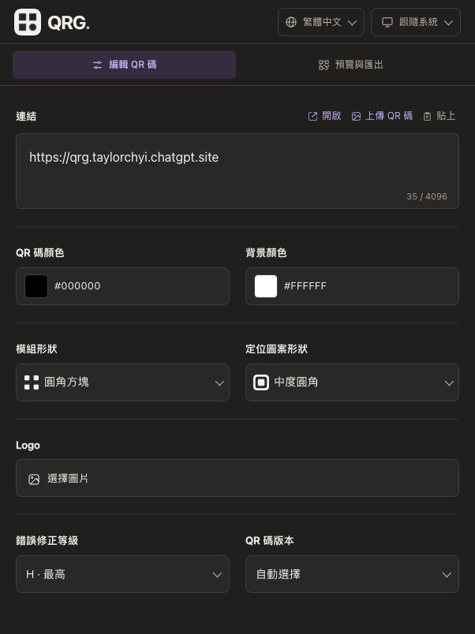
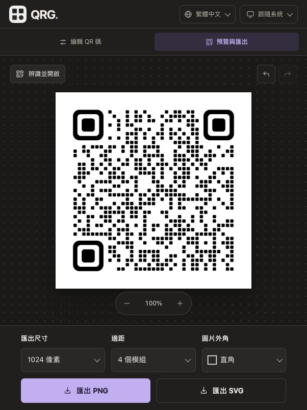

<h1 align="center">QRG</h1>

  
  
  

<a href="README.md">简体中文</a> · <strong>繁體中文</strong> · <a href="README.en.md">English</a> · <a href="README.ja.md">日本語</a> · <a href="README.ko.md">한국어</a> · <a href="README.es.md">Español</a> · <a href="README.fr.md">Français</a> · <a href="README.de.md">Deutsch</a>

<strong>線上製作 QR Code，為每個連結找到合適的樣式。</strong>

即時預覽 · 自訂顏色與 Logo · 匯出 PNG / SVG · 在瀏覽器中處理

<a href="https://qrg.taylorchyi.chatgpt.site/?lang=zh-TW"><strong>立即使用 →</strong></a>

QRG 是線上 QR Code 製作工具。貼上連結或輸入文字，調整設計後即可下載，放到網站、海報、名片或簡報中使用，無須安裝。

  
  

## 三步製作 QR Code

1. 開啟 [QRG 線上版](https://qrg.taylorchyi.chatgpt.site/?lang=zh-TW)，貼上連結或輸入文字。
2. 選擇顏色、形狀與背景，需要時加入 Logo，邊調整邊看預覽。
3. 下載 PNG，或選擇 SVG 進一步排版與印刷。

已有 QR Code 圖片？可上傳、拖入或貼上 PNG、JPEG、WebP 圖片，讀取內容後重新設計。匯入只會擷取內容，樣式由你重新設定。

## 做出自己的風格

| 功能 | 可以做什麼 |
| --- | --- |
| 顏色與背景 | 自訂碼點與背景顏色，也可使用透明背景。 |
| 形狀與圓角 | 選擇方形、圓角方塊或圓形碼點，分別調整定位標記與整張圖片的外角。 |
| 品牌 Logo | 上傳並裁切圖片，調整大小及周圍留白；可用選項會隨 QR Code 規格變化。 |
| 即時編輯 | 自動更新預覽，支援復原、重做及預覽縮放。 |
| PNG 與 SVG | PNG 可匯出為 256、512、1024、2048 或 4096 像素；SVG 便於後續排版與放大。 |
| 圖片辨識 | 讀取現有 QR Code 的內容，也能辨識目前預覽並開啟其中的網頁連結。 |

電腦版並排顯示編輯與預覽；手機版可切換編輯和匯出畫面。支援淺色、深色及跟隨系統外觀，並提供簡體中文、繁體中文、English、日本語、한국어、Español、Français、Deutsch 八種介面語言。

## 在瀏覽器中完成

公開線上版在你的瀏覽器中產生及辨識 QR Code。文字、Logo 和匯入的圖片不會上傳至 QR Code 處理服務，也不會呼叫第三方 QR Code 產生介面。

用於印刷或加入 Logo 時，請保留足夠的顏色對比與邊距，並在實際展示環境中掃描成品確認。

## 自行架設與命令列

除了線上使用，也可以在自己的伺服器執行 QRG 網頁服務，或透過命令列產生 PNG、SVG。自行架設的網頁版會由你的 QRG 伺服器處理內容與圖片。

安裝、API 與維護說明見 [AGENTS.md](AGENTS.md)。
